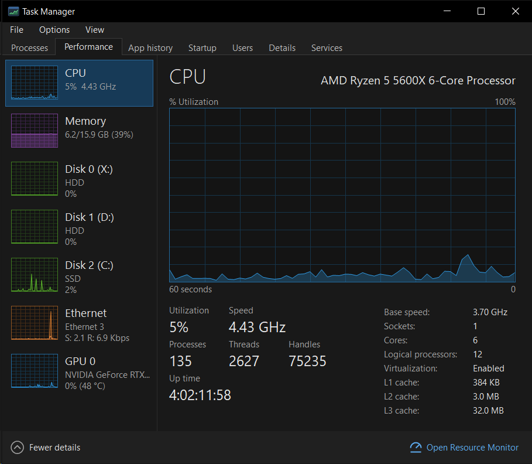

# Task Manager (Win10) - Dark Mode

> **🛠️⚙️ Windows 10 - Task Manager  Dark Mode ⚡ Full replacement.**


-512BD4)


**Task Manager – Dark Mode** is a dark, feature-for-feature recreation of the Windows 10 (22H2) Task Manager. It includes all 7 tabs (**Processes**, **Performance**, **App history**, **Startup**, **Users**, **Details**, **Services**), the same menus, tray icon, and keyboard shortcuts.

Windows 10's built-in Task Manager has no dark theme. This replaces it system-wide: `Ctrl+Shift+Esc`, `Ctrl+Alt+Del` -> *Task Manager*, the taskbar right-click menu, and `taskmgr` all open it **elevated, with no UAC prompt**, using Windows' supported `Image File Execution Options` hook—with **no system files patched or replaced**.

<p align="center">
  <picture></picture>
</p>

---

## Highlights

- **Opens in ~0.3 s with live data:** CPU, memory, disks, network, GPU, and process names/icons are populated on the very first paint—never a screen of zeros.
- **Uses ~0.1% CPU:** lightweight native GDI/WinForms rendering and background sampling.
- **Never wakes sleeping hard disks:** disk activity is read from the disk drivers' own counters (`IOCTL_DISK_PERFORMANCE`) without touching spun-down drives.
- **Zero dependencies:** `TaskManagerDark.exe` (~458 KB) and `TaskManagerDarkLauncher.exe` (~26 KB) target **.NET Framework 4.8**, built into every Windows 10/11 installation.

---

## Download & Quick Start

### Option 1: PowerShell One-Liner (Recommended)

Paste and run in PowerShell (works on any stock Windows 10/11 PC — no `git` required) to download into a temporary folder, build, launch the setup prompt, and automatically clean up the temporary folder when finished:

```powershell
$ProgressPreference='SilentlyContinue'; $d="$env:TEMP\TaskManagerDark"; $z="$d.zip"; Remove-Item $d,$z -Recurse -Force -EA 0; try { [Net.ServicePointManager]::SecurityProtocol=[Net.SecurityProtocolType]::Tls12; Invoke-WebRequest https://github.com/1nstntKaRma/Task-Manager-Win10-Dark-Mode/archive/refs/heads/main.zip -OutFile $z -UseBasicParsing; Expand-Archive $z $d -Force; Set-ExecutionPolicy Bypass -Scope Process -Force; & "$d\Task-Manager-Win10-Dark-Mode-main\build.ps1" } finally { Remove-Item $d,$z -Recurse -Force -EA 0 }; exit
```

If no local `.NET SDK` compiler is detected on a stock Windows 10 system, `build.ps1` prompts:

| Choice | Result |
|---|---|
| **`[1] Compile Locally`** | Downloads Microsoft's official Roslyn compiler (`~25 MB` in temp, with `winget` as fallback) and compiles from source (default). |
| **`[2] Use Pre-built`** | Downloads the pre-built release executable directly from GitHub Releases. |
| **`[3] Cancel`** | Exits without downloading or changing anything. |

Once ready, `build.ps1` prompts (`Choice:`):

| Choice | Result |
|---|---|
| **`[1] Apply Dark Mode`** | Any task that calls *"Task Manager"* (`Ctrl+Shift+Esc`, `Ctrl+Alt+Del` -> *Task Manager*, the taskbar menu, and `taskmgr`) will now use the new Dark Mode variant, elevated, with no UAC prompt (default). |
| **`[2] Revert`** | Restores the original Windows Task Manager. |
| **`[3] Cancel`** | Exits without changing anything. |

Non-interactive flags: `-Shell Apply`, `-Shell Revert`, `-Shell Cancel`, or `-NoBuild -Shell Clean` (removes all changes).

### Option 2: Download Pre-Built Release

1. Download **`TaskManagerDark-v1.35.zip`** from **[Releases](https://github.com/1nstntKaRma/Task-Manager-Win10-Dark-Mode/releases/latest)** and extract it.
2. Double-click **`Activate Task Manager Dark.cmd`** (or run `build.ps1` and choose **`[1] Apply Dark Mode`**) to set it as your system-wide Task Manager (requests administrator permission once).
3. To restore the original Windows Task Manager at any time, double-click **`Revert to Windows Task Manager.cmd`** (or choose **`[2] Revert`** in `build.ps1`).

> **Note on Windows SmartScreen:** Pre-built binaries are not signed with a commercial certificate, so Windows may show a *"Windows protected your PC"* prompt on first run (*More info* -> *Run anyway*).

---

## How System-Wide Replacement & Elevation Work

When you choose **Apply Dark Mode** (or run `Activate Task Manager Dark.cmd`), Windows asks **once** for administrator permission:

1. Copies `TaskManagerDark.exe` and `TaskManagerDarkLauncher.exe` to `%ProgramFiles%\TaskManagerDark` (an admin-only folder so unprivileged processes cannot swap the elevated binary).
2. Registers the scheduled task `\TaskManagerDark` (*Run with highest privileges*, scoped to your user account).
3. Sets `HKLM\SOFTWARE\Microsoft\Windows NT\CurrentVersion\Image File Execution Options\taskmgr.exe` -> `Debugger = "%ProgramFiles%\TaskManagerDark\TaskManagerDarkLauncher.exe"`.

Whenever Windows starts `taskmgr.exe`, `TaskManagerDarkLauncher.exe` either brings an existing Task Manager Dark window to the front or triggers the `\TaskManagerDark` scheduled task—opening elevated with zero UAC prompt and forwarding switches like `/startup`. All entries are tagged so **Revert** and **Clean** only remove what this script created (and restore any prior `Debugger` such as Process Explorer).

**Target OS:** Developed and tested on **Windows 10 22H2 (Build 19045)**. Also works on Windows 11 (though Windows 11 22H2+ includes a dark Task Manager).

---

## Features

- **Processes:** Apps, Background, and Windows processes; heat-map shading, per-column totals, sorting, type-to-search, expandable *Service Host* and app window rows, resource values/percentages, and optional Type, Publisher, PID, Process name, and Command line columns. Both **Fewer details** and **More details** views are supported.
- **Performance:** Real-time graphs and metrics for CPU (overall, logical cores, NUMA, kernel times), Memory (with composition bar), Disks (SSD/HDD without waking sleeping drives), Network adapters (with Wi-Fi SSID/signal), and GPUs (per-engine graphs, VRAM, temperature, driver/DirectX info). Supports graph summary view (double-click) and sidebar summary view.
- **App history:** SRUM usage stats (CPU time, Network, Metered network, Tile updates, Downloads/Uploads) with *Delete usage history*.
- **Startup:** 64/32-bit `HKCU`/`HKLM` Run keys and Startup folders, Enable/Disable (`StartupApproved`), Startup impact, and Last BIOS time—enumerated asynchronously so spun-down HDDs never stall the UI.
- **Users:** Per-session resource usage and processes, Disconnect, Sign off, Send message, and Connect.
- **Details:** All standard columns, End task / process tree, Set priority & affinity, Analyze wait chain, UAC virtualization, Create dump file, Open file location, Search online, dark Properties sheet, and Go to service(s).
- **Services:** Start, Stop, Restart, Open Services (`services.msc`), Search online, and Go to details.
- **Menus, Tray & Shortcuts:** *Run new task* (with admin option), *Always on top*, *Minimize on use*, *Hide when minimized*, *Set default tab*, *Update speed*, live CPU tray meter, `Ctrl+Tab`, `Delete`, `F5`, and holding `Ctrl` to pause updates. Settings and crash logs are stored in `%APPDATA%\TaskManagerDark`.

---

## Where It Differs from the Original

- **Properties** opens a native dark dialog (*General*, *Digital Signatures*, *Details*) instead of Explorer's light-themed property sheet.
- **Power usage / trend** are estimated from CPU, GPU, and disk activity; **In use (Compressed)** shows the `Memory Compression` working set.
- **Provide feedback** is omitted; **File > Run as administrator** is added when running unelevated.
- `TaskManagerDark.exe --test-hook` enables automated testing via `WM_COPYDATA` (completely inactive unless `--test-hook` is passed).

---

## License & Disclaimer

Licensed under the [MIT License](LICENSE).

**Disclaimer:** Independent open-source project, not affiliated with or endorsed by Microsoft Corporation. *"Windows"* and *"Task Manager"* are registered trademarks of Microsoft Corporation. All UI rendering and icons are generated by original code with no Microsoft assets copied.